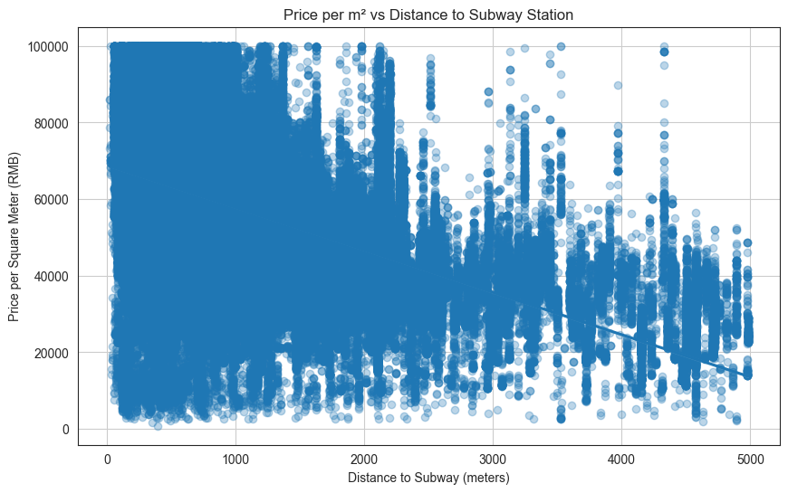
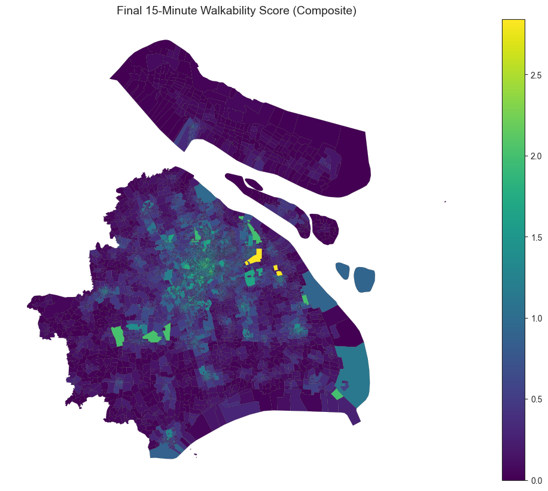
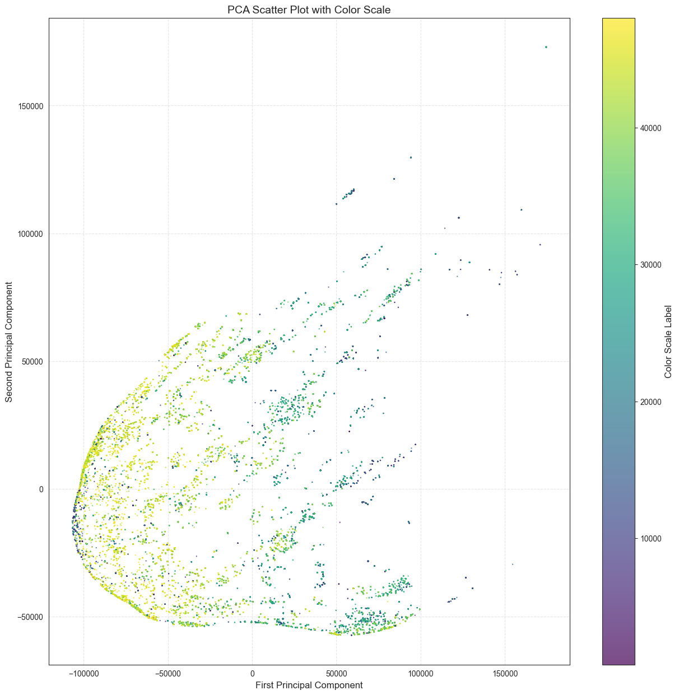

# Shanghai Urban Analytics — What drives housing value?



Data analysis of the Shanghai housing market combining **300,000+ housing listings** and over **1 million points of interest (POIs)** to identify the drivers of housing prices and map gaps in access to urban amenities.

Academic project carried out during an exchange semester at the **Sino-European University of Technology (UTSEUS), Shanghai**, February–July 2025. Individual project — I carried out all three analyses below (regression, PCA, and accessibility mapping) myself.

## Research questions

1. Which factors explain differences in housing prices across Shanghai?
2. Which areas show the largest gaps in access to amenities (transport, schools, healthcare, shops)?

## Data

| Dataset | Size | Source |
|---|---|---|
| Housing listings | 467,029 raw listings (Anjuke, 2017); narrowed to ~342k or ~123k depending on the filters applied per analysis | [Anjuke](https://shanghai.anjuke.com/sale), scraped for UTSEUS in 2017 |
| Points of interest | ~1.05M (2017 vintage, used for the regression and PCA) + ~1.75M (2024 vintage, used for the accessibility analysis) | Gaode/AMap — see `data/README.md` for details |
| Administrative boundaries | 5,614 community-level polygons | Not documented in the original project files |

Raw data is not included in this repository because of its size and licensing. See [`data/README.md`](data/README.md) to rebuild it.

## Methodology

1. **Cleaning** — convert the Anjuke fields to numeric and drop unparseable rows (467,029 → 463,067), restrict listings to a Shanghai bounding box (→ 392,383), then apply per-analysis filters: ≤5 km from a subway station and ≤100,000 RMB/m² for the regression (→ 342,223 listings), a 3-standard-deviation price filter for the PCA (→ 123,099 listings).
2. **Spatial feature engineering** — nearest-subway distance via a BallTree (regression); distance from each listing to the nearest POI of every category code via a KDTree, across 287 POI categories (PCA); 5/10/15-minute walking buffers (at 1.31 m/s) with POI counts inside each buffer (accessibility).
3. **Dimensionality reduction** — PCA on the 287 POI-distance features. In the notebook's final run, PC1 and PC2 explain 38.1% and 23.2% of the variance respectively (~61% combined). Note: an earlier cell in the same notebook prints 52.4%/18.3% — a stale output left over from an earlier version of the filtered dataset that was never rerun after the final filtering step; the 38.1%/23.2% figures are the ones consistent with the notebook's final, live results.
4. **Regression** — OLS of price per m² on distance to the nearest subway station.
5. **Accessibility mapping** — MinMax-scaled POI counts within the 5/10/15-minute buffers, summed into a single composite walkability score per community.

## Key results

- Each additional meter of distance from a subway station is associated with an **11.06 RMB/m² decrease** in price per square meter (OLS, R² = 0.217, n = 342,223 listings within 5 km of a station).
- The first two principal components of local POI density together explain **~61% of the variance** (38.1% + 23.2%) in the amenity mix surrounding each listing.
- **Central Shanghai communities score far higher** on the composite walkability index than peripheral and suburban ones, showing clear gaps in access to daily, mid-range, and large-scale services.




## Repository structure

```
shanghai-urban-analytics/
├── data/            # raw data goes here (not versioned) + data/README.md
├── notebooks/       # the 3 analysis notebooks, numbered in order
├── figures/         # exported charts and maps
├── requirements.txt
└── README.md
```

## Run it

```bash
git clone https://github.com/maxenceherve/shanghai-urban-analytics.git
cd shanghai-urban-analytics
pip install -r requirements.txt
jupyter notebook notebooks/
```

See [`data/README.md`](data/README.md) for how to obtain the raw data each notebook expects.

## Tech stack

Python · pandas · NumPy · GeoPandas · scikit-learn · statsmodels · SciPy · Matplotlib · Seaborn · contextily
